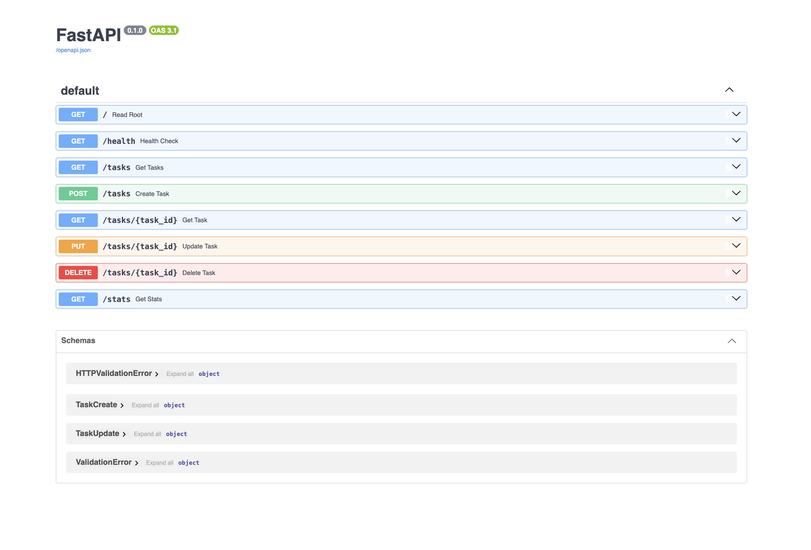

# FlyRank Backend Internship - Week 2: First CRUD API

This is a RESTful API built with **Python 3.10** and **FastAPI** that manages a simple in-memory to-do list. It supports the full CRUD (Create, Read, Update, Delete) cycle and includes automatic interactive documentation via Swagger UI.

## How to Install and Run
1. Ensure you have Python installed.
2. Install the required packages: `pip install fastapi uvicorn`
3. Start the server on localhost:
```bash
uvicorn main:app --reload
```
The API will be available at `http://localhost:8000`.

## API Endpoints
| CRUD Operation | HTTP Method | Endpoint | Description |
| :--- | :--- | :--- | :--- |
| **-** | GET | `/` | Returns API metadata |
| **-** | GET | `/health` | Returns server health status |
| **Read** | GET | `/tasks` | Lists all tasks |
| **Read** | GET | `/tasks/{task_id}` | Gets a specific task by ID |
| **Create** | POST | `/tasks` | Creates a new task |
| **Update** | PUT | `/tasks/{task_id}` | Updates an existing task |
| **Delete** | DELETE | `/tasks/{task_id}` | Deletes a task |
| **Extra** | GET | `/stats` | Returns task statistics |

## Example `curl` Output (GET /tasks/1)
```bash
$ curl -i http://localhost:8000/tasks/1
HTTP/1.1 200 OK
date: Mon, 14 Sep 2026 09:37:46 GMT
server: uvicorn
content-length: 62
content-type: application/json

{"id":1,"title":"Buy milk","done":false}
```

## Swagger UI Screenshot
Interactive documentation is available at `http://localhost:8000/docs`.


## Stage 7: AI Rematch (AI vs Me)

After manually building the API, I prompted an AI assistant (Claude) to generate the same CRUD API from scratch. I stored its output in `ai-version/main.py` and compared it against my original code. 

**What the AI did better (or more professionally):**
* **Data Modeling:** The AI used a dedicated Pydantic model (`class Task(BaseModel)`) for the in-memory storage, whereas I used a raw Python list of dictionaries.
* **Code Reusability:** The AI abstracted the search logic into a `find_task()` helper function, eliminating the need to repeat `for` loops inside the GET, PUT, and DELETE endpoints.
* **Response Models:** The AI explicitly defined `response_model=Task` and `response_model=list[Task]` in the decorators. This provides stricter typing and makes the Swagger UI documentation more accurate.
* **Schema Validation:** The AI utilized Pydantic's `@field_validator` to handle empty string validations at the schema level, rather than doing it inside the route functions.

**Where my code was better (or what the AI missed):**
* **ID Generation:** I used a dynamic `max()` function to safely calculate the next available ID. The AI relied on a global state variable (`global _next_id`), which can be problematic in multi-threaded environments.
* **Missing Features:** The AI did not include the `/stats` endpoint. Since I didn't explicitly request it in the prompt, it proved that the AI's output is strictly limited by the prompt's completeness.