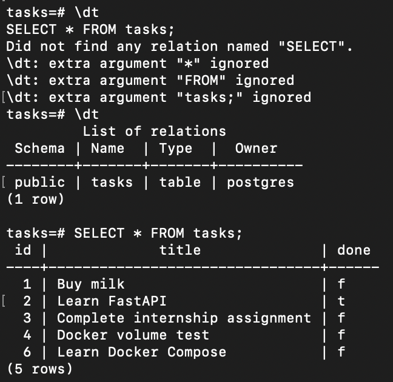

# FlyRank Backend Internship - Week 3: Containerize your stack

This is the task CRUD API running against a containerized **PostgreSQL** database in **Docker**. The entire stack (FastAPI app + Postgres database) starts together with a single command via **Docker Compose**.

```
Assignment 1:  Client  ->  FastAPI  ->  In-memory list
Assignment 2:  Client  ->  FastAPI  ->  SQLite (tasks.db)
Assignment 3:  Client  ->  FastAPI  ->  PostgreSQL (Docker container)
```

The endpoints, status codes, and request/response contracts remain identical to A1 and A2.

---

## Why Containerize & Why Postgres?
1. **Zero environment conflicts ("Works on my machine"):** You don't have to install or configure PostgreSQL directly on your host OS. The official Docker image sets up an isolated, consistent database runtime instantly.
2. **Production-grade database:** Unlike SQLite, PostgreSQL is designed for concurrent writes, rich querying, and high throughput.
3. **Infrastructure as Code:** Everything required to run the stack is codified in `Dockerfile` and `compose.yaml`.
4. **Clean persistence:** Data persists across container restarts using a Docker named volume (`taskdata`).
5. **Security:** Credentials are never hardcoded. They are loaded securely from `.env` (git-ignored, template in `.env.example`).

---

## How to Install and Run

### 1. Requirements
- Docker and Docker Compose installed (Docker Desktop or Podman)

### 2. Configuration
Copy the example environment file:
```bash
cp .env.example .env
```
*(You can customize `POSTGRES_PASSWORD`, `POSTGRES_DB`, etc. inside `.env` if desired)*

### 3. Start the entire stack with ONE command
```bash
docker compose up --build
```
Or run detached in the background:
```bash
docker compose up -d
```

The API will be available at:
- **API root:** `http://localhost:8000`
- **Swagger Docs:** `http://localhost:8000/docs`

To stop the stack:
```bash
docker compose down
```
*(Your data remains safe inside the Docker volume `taskdata` across restarts)*

---

## Environment Variables (.env)
Credentials are read dynamically from `.env`. A committed template is available at [`.env.example`](.env.example):

| Variable | Description | Default in Compose |
| :--- | :--- | :--- |
| `POSTGRES_USER` | Database superuser | `postgres` |
| `POSTGRES_PASSWORD` | Database password | `dev` |
| `POSTGRES_DB` | Database name | `tasks` |
| `DATABASE_URL` | App connection string | `postgresql://postgres:dev@db:5432/tasks` (internal) |

---

## API Endpoints
| Operation | Method | Endpoint | Description | Success | Errors |
| :--- | :--- | :--- | :--- | :--- | :--- |
| **Metadata** | GET | `/` | API version and metadata | 200 | |
| **Health** | GET | `/health` | Server and Postgres ping status (`db: "ok"`) | 200 | |
| **List** | GET | `/tasks` | List tasks (supports `?search=`, `?done=`, `?sort=`) | 200 | 400 |
| **Get** | GET | `/tasks/{task_id}` | Get single task by ID | 200 | 404 |
| **Create** | POST | `/tasks` | Create task (`title` required) | 201 | 400 |
| **Update** | PUT | `/tasks/{task_id}` | Update title or done status | 200 | 400, 404 |
| **Delete** | DELETE | `/tasks/{task_id}` | Delete task | 204 | 404 |
| **Stats** | GET | `/stats` | Task metrics calculated directly in SQL | 200 | |

---

## Sample `curl` Session

Creating a new task against the live containerized stack:
```bash
$ curl -i -X POST http://localhost:8000/tasks \
  -H "Content-Type: application/json" \
  -d '{"title":"Learn Docker Compose"}'

HTTP/1.1 201 Created
date: Tue, 13 Oct 2026 08:06:54 GMT
server: uvicorn
content-length: 52
content-type: application/json

{"id":6,"title":"Learn Docker Compose","done":false}
```

Updating the task:
```bash
$ curl -i -X PUT http://localhost:8000/tasks/6 \
  -H "Content-Type: application/json" \
  -d '{"done":true}'

HTTP/1.1 200 OK
{"id":6,"title":"Learn Docker Compose","done":true}
```

---

## Database Verification (PostgreSQL in Container)
You can inspect the table inside the running container using `psql`:

```bash
docker compose exec db psql -U postgres -d tasks -c "\dt"
```
Output:
```
         List of relations
 Schema | Name  | Type  |  Owner   
--------+-------+-------+----------
 public | tasks | table | postgres
(1 row)
```

Viewing tasks directly:
```bash
docker compose exec db psql -U postgres -d tasks -c "SELECT * FROM tasks;"
```
Output:
```
 id |             title              | done 
----+--------------------------------+------
  1 | Buy milk                       | f
  2 | Learn FastAPI                  | t
  3 | Complete internship assignment | f
  4 | Docker volume test             | f
(4 rows)
```

### Database Screenshot


---

## Automated Endpoint Tests
Test all endpoints against the running stack:
```bash
python test_api.py
```
*(All assertions verify health check, full CRUD lifecycle, validation errors, and query filtering)*