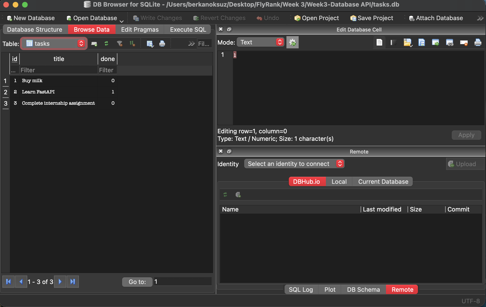

# FlyRank Backend Internship - Week 3: CRUD API on SQLite

> A3 (Containerize your stack) in progress. Postgres runs in Docker:
> `docker run --name taskdb -e POSTGRES_PASSWORD=dev -e POSTGRES_DB=tasks -p 5432:5432 -v taskdata:/var/lib/postgresql/data -d postgres:17`

This is the Week 2 FastAPI task API, now backed by a real **SQLite** database instead of an in-memory list. The endpoints, request bodies, responses and status codes are exactly the same as in Assignment 1. Only the storage layer changed, so tasks now survive a server restart.

```
Assignment 1:   Client  ->  API  ->  a list in memory
Assignment 2:   Client  ->  API  ->  SQLite database (tasks.db)
```

## Why SQLite?
1. **Single file.** The whole database is `tasks.db`. No database server to install, configure or run.
2. **Zero setup.** `sqlite3` ships with Python's standard library, so there is nothing extra to install.
3. **Survives restarts.** Data is written to disk, so stopping the server no longer wipes the tasks.
4. For a small single-server app like this, SQLite is fast and reliable. A multi-user production system with many concurrent writers would move to something like Postgres, and thanks to this design only the storage code would change.

## How to Install and Run
Requires Python 3.10+.

```bash
pip install -r requirements.txt && uvicorn main:app --reload
```

The API is available at `http://localhost:8000` and Swagger UI at `http://localhost:8000/docs`.

## Where the database lives
1. `tasks.db` is created automatically next to `main.py` the first time the server starts.
2. On startup the app runs `CREATE TABLE IF NOT EXISTS tasks (...)`, then counts the rows and inserts the three example tasks **only if the table is empty**. Restarting never duplicates them.
3. `tasks.db` is listed in `.gitignore`, so every fresh clone starts with a clean, seeded database. To reset your data, delete `tasks.db` and restart.

Schema:

| Column | Type | Notes |
| :--- | :--- | :--- |
| `id` | INTEGER | Primary key, assigned by SQLite |
| `title` | TEXT | Not null |
| `done` | INTEGER | Boolean stored as `0` / `1`, returned as `false` / `true` |

## API Endpoints
| CRUD Operation | HTTP Method | Endpoint | SQL behind it | Success | Errors |
| :--- | :--- | :--- | :--- | :--- | :--- |
| **-** | GET | `/` | none | 200 | |
| **-** | GET | `/health` | none | 200 | |
| **Read** | GET | `/tasks` | `SELECT * FROM tasks` | 200 | |
| **Read** | GET | `/tasks/{task_id}` | `SELECT * FROM tasks WHERE id = ?` | 200 | 404 |
| **Create** | POST | `/tasks` | `INSERT INTO tasks (title, done) VALUES (?, ?)` | 201 | 400 |
| **Update** | PUT | `/tasks/{task_id}` | `UPDATE tasks SET title = COALESCE(?, title), done = COALESCE(?, done) WHERE id = ?` | 200 | 400, 404 |
| **Delete** | DELETE | `/tasks/{task_id}` | `DELETE FROM tasks WHERE id = ?` | 204 | 404 |
| **Extra** | GET | `/stats` | task statistics | 200 | |

Every query uses `?` placeholders (parameterized queries). User input is never glued into a SQL string, which protects the database from SQL injection.

## Example `curl` session (persistence across a restart)
```bash
$ curl -i -X POST http://localhost:8000/tasks -H "Content-Type: application/json" -d '{"title":"Stage 3 task"}'
HTTP/1.1 201 Created
{"id":4,"title":"Stage 3 task","done":false}

$ curl -i -X PUT http://localhost:8000/tasks/4 -H "Content-Type: application/json" -d '{"done":true}'
HTTP/1.1 200 OK
{"id":4,"title":"Stage 3 task","done":true}

# stop the server (Ctrl+C) and start it again

$ curl -i http://localhost:8000/tasks/4
HTTP/1.1 200 OK
{"id":4,"title":"Stage 3 task","done":true}

$ curl -i -X DELETE http://localhost:8000/tasks/4
HTTP/1.1 204 No Content

$ curl -i http://localhost:8000/tasks/4
HTTP/1.1 404 Not Found
{"detail":"Task 4 not found"}
```

## Stage 4: SQL by hand
I opened `tasks.db` in **DB Browser for SQLite** while the API was running and ran the queries in [`sql/explore.sql`](sql/explore.sql).

Example query:
```sql
SELECT * FROM tasks WHERE done = 1;
```
It returned a single row, `2 | Learn FastAPI | 1`, the only seeded task that is already completed.

After running `UPDATE tasks SET done = 1;` in DB Browser, `GET /tasks` immediately returned all three tasks with `"done": true`, without restarting the server. The API and DB Browser read the same file, so there is one source of truth.

### DB Browser screenshot


## Extras: let the database do the work
| Feature | Example | SQL |
| :--- | :--- | :--- |
| Search | `GET /tasks?search=milk` | `WHERE title LIKE ?` with `%milk%` |
| Filter by status | `GET /tasks?done=true` | `WHERE done = ?` |
| Sort alphabetically | `GET /tasks?sort=title` | `ORDER BY title COLLATE NOCASE` |
| Real statistics | `GET /stats` | `SELECT COUNT(*), SUM(done) FROM tasks` |

The filters can be combined, for example `GET /tasks?search=learn&done=true&sort=title`. Without query parameters `GET /tasks` behaves exactly like Assignment 1.

## Stretch goals
1. **Index.** `CREATE INDEX idx_tasks_done ON tasks (done)` backs the `?done=` filter. An index is a sorted lookup structure that lets the database find matching rows without scanning the whole table.
2. **Transaction.** The three seed inserts run inside one transaction (commit on success, rollback on error in `get_db()`). This matters because it is all-or-nothing: a crash mid-seed can never leave the table half-seeded.
3. **Proof the API didn't change.** [`test_api.py`](test_api.py) contains the A1 endpoint checks (every path, body, response and status code). I ran the exact same `test_a1_contract` against the Week 2 in-memory `main.py` and against this SQLite version, and it passes on both. Identical tests passing on both is the proof that storage is just an implementation detail: the client-facing contract is the same, only what sits behind it changed.

Run the tests (they use a temporary database and never touch `tasks.db`):
```bash
python test_api.py
```

## Week 2 history
This repo continues from Assignment 1. The Stage 0 to Stage 7 commits of the in-memory version are still in `git log`, and `ai-version/` holds the Week 2 AI rematch code.